<div align="center">


[](https://git.io/typing-svg)

<br>

[](#-what_is_this)
[](#-data_sources)
[](https://threejs.org/)
[](#-prior_art)

[](https://github.com/Ringmast4r/agent-city/stargazers)
[](https://github.com/Ringmast4r/agent-city/network/members)
[](#)
[](https://github.com/Ringmast4r/agent-city/commits/main)
[](#)

</div>

---

## `> what_is_this`

```bash
you@github:~$ cat project.txt

  PURPOSE:        render my own Claude Code sessions as an isometric city
  DISTRICTS:      the numbered D: libraries (00 Database ... 27 Chrome Ext)
  BUILDINGS:      real files - height = LOC, footprint = size
  CITIZENS:       real tool calls and subagents, read from transcripts
  CORPUS:         1,553 sessions | 2.5 GB | biggest session 17,256 lines
  STATUS:         [ IDEA STAGE - NOTHING BUILT YET ]
```

> **The city is not a simulation, it is a read-out.** Every person on screen is an
> actual tool call that actually happened, in an actual file, at an actual timestamp.

Full design doc: **[IDEA.md](IDEA.md)**. Competitor assets and what they look like:
**[reference/](reference/README.md)**.

---

## `> is_it_possible`

Yes, and it is less speculative than it sounds. Every individually risky piece is
already shipping in someone else's project. Nothing here needs inventing - it needs
combining.

| Risky-sounding piece | Already proven by | Verdict |
|:--|:--|:--|
| Reading agent activity out of Claude Code live | `pixel-agents`, 9,243 stars | Solved, two ways |
| Parsing a multi-GB `~/.claude/projects` corpus | `token-dashboard` - Python stdlib + SQLite, 20-60 s full scan | Solved, at this exact scale |
| Turning a file tree into a 3D city in a browser | `JSCity` (three.js) | Solved |
| Animating repo history over a time axis | `Gource`, since 2009 | Solved |
| Little people walking around doing agent work | `pixel-agents`, `agent-town`, `AI Town` | Solved |

**What nobody has done is join them.** The field splits into three camps that have
never met - see [reference/README.md](reference/README.md) for the screenshots that
make this obvious:

| Camp | Example | The map means... |
|:--|:--|:--|
| Map-as-office | `pixel-agents` | Nothing. It is furniture. All signal is in the characters |
| Map-as-workflow | `agent-town` | Task state - agents stand in `Backlog` / `In Progress` / `Done` zones |
| Map-as-codebase | `CodeCity`, `JSCity` | The code itself - but static, empty, no clock and no people |

Agent City is the join: **real terrain from the actual file tree, walked by real
citizens from actual tool calls, over a real time axis** - plus the thing nobody else
has at all, a back catalogue of 1,553 sessions to replay as a chronicle.

The three camps, in pixels:

<p>


</p>

---

## `> prior_art`

Surveyed 2026-09-11, **sorted by GitHub stars**. Screenshots and sprites are under [`reference/`](reference/README.md) so you can see what each one actually looks like.

### Agent-as-citizen (the people)

| Project | Stars | Stack | How it knows what the agent is doing |
|:--|--:|:--|:--|
| **[Generative Agents](https://github.com/joonspk-research/generative_agents)** * | **22,087** | Python + Django, Phaser frontend (Smallville) | Simulated. The 2023 paper that started the aesthetic |
| **[AI Town](https://github.com/a16z-infra/ai-town)** * | **10,473** | **PixiJS + pixi-react**, **Convex** (db + serverless + vector search), Clerk, Fly.io | Simulated. 60 ticks/s bundled into one DB step/s; clients replay "historical objects" for smooth motion between sparse writes |
| **[pixel-agents](https://github.com/pixel-agents-hq/pixel-agents)** * | **9,243** | TypeScript, React 19 + Vite, **Canvas 2D**, Fastify, Node 20+, esbuild, Vitest + Playwright | **Real telemetry.** Claude Code **hooks primary** (`SessionStart`, `PreToolUse`, `PermissionRequest`, `Stop`) with a **JSONL fallback** over `~/.claude/projects/`. Both normalise into one `AgentEvent` model behind a typed `HookProvider` interface |
| [agent-office](https://github.com/harishkotra/agent-office) * | 265 | Phaser.js, Colyseus, React, SQLite, Ollama | Simulated - a think loop every ~15 s. SQLite memories with embedding + cosine recall |
| [agent-town](https://github.com/rafapetter/agent-town) * | 5 | Pure TypeScript, **zero dependencies**, Canvas 2D, procedural pixel art | Direct TS API (`addAgent`, `updateAgent`, `logActivity`) plus a WebSocket bridge for Claude Code / Cursor / Codex |

### Code-as-city (the buildings)

| Project | Stars | Stack | Mapping |
|:--|--:|:--|:--|
| **[Gource](https://github.com/acaudwell/gource)** * | **13,138** | C++, OpenGL/SDL | Repo history as an animated tree, committers as avatars. The time axis done right |
| **[3d.city](https://github.com/lo-th/3d.city)** * | **1,744** | three.js, WebGL2/WebGPU | Procedural city builder - layout, camera, textured blocks |
| **[JSCity](https://github.com/aserg-ufmg/JSCity)** * | **1,400** | **three.js** | Folders are districts, files are sub-districts, **buildings are functions**; height = LOC, base = variable count |
| [city-tour](https://github.com/jstrait/city-tour) * | 88 | three.js, WebGL | Procedural city generation - layout and camera reference |
| [CodeCity](https://wettel.github.io/codecity.html) * (Wettel, 2008) | — | VisualWorks Smalltalk on Moose, OpenGL | Packages are districts, classes are buildings, methods are floors. **The target look.** No GitHub repo; academic original |

### Claude Code transcript tooling (the data pipeline)

| Project | Stars | Stack | Notes |
|:--|--:|:--|:--|
| [claude-code-transcripts](https://github.com/simonw/claude-code-transcripts) | **1,686** | Python | JSONL to paginated static HTML |
| [claude-code-log](https://github.com/daaain/claude-code-log) | 1,213 | Python CLI | JSONL to HTML / Markdown |
| **[token-dashboard](https://github.com/nateherkai/token-dashboard)** | 694 | **Python 3 stdlib only**, **SQLite**, vanilla JS + ECharts, **no build step** | Scans `~/.claude/projects/`, dedupes by `message.id`, **20-60 s full initial scan on a heavy machine**, re-scan every 30 s over SSE. Tool and file heatmaps |
| [ClaudeCodeJSONLParser](https://github.com/amac0/ClaudeCodeJSONLParser) | 20 | HTML tool | JSONL events and git history on one timeline - closest to the chronicle idea |

---

## `> look`

Every visual file under `reference/` is embedded below — **350 images**, highest stars first.

| Project | Stars | Images |
|:--|--:|--:|
| [Generative Agents](#generative-agents) | 22,087 | 99 |
| [Gource](#gource) | 13,138 | 3 |
| [AI Town](#ai-town) | 10,473 | 57 |
| [pixel-agents](#pixel-agents) | 9,243 | 64 |
| [3d.city](#3dcity) | 1,744 | 15 |
| [JSCity](#jscity) | 1,400 | 80 |
| [agent-office](#agent-office) | 265 | 7 |
| [city-tour](#city-tour) | 88 | 2 |
| [agent-town](#agent-town) | 5 | 11 |
| [CodeCity](#codecity) | — | 12 |

### Generative Agents

[Generative Agents](https://github.com/joonspk-research/generative_agents) — **22,087 ★** — `99` files in `reference/generative-agents/`

**`cover.png`**


**`smallville-cover.png`**


**`the_ville2.png`**

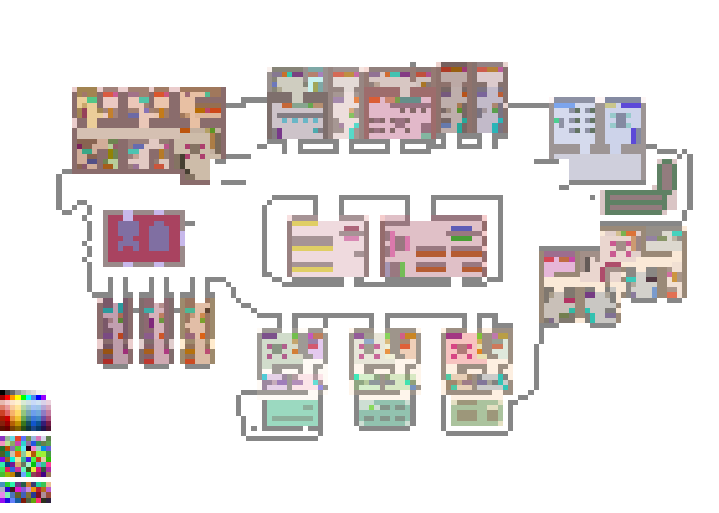

**`the_ville_collision.png`**


<p>

</p>

#### `generative-agents/characters`

<p>
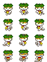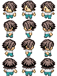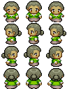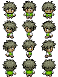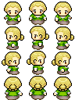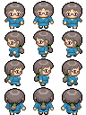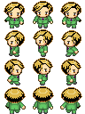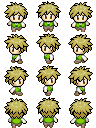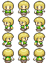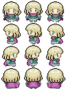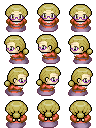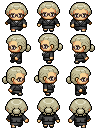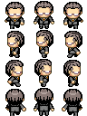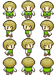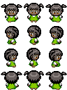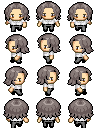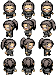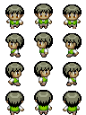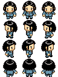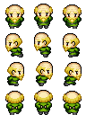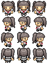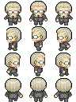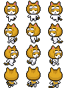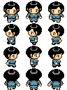
</p>

#### `generative-agents/characters/original`

<p>
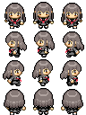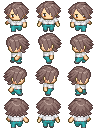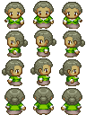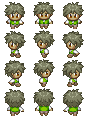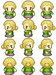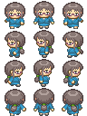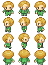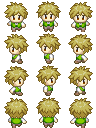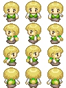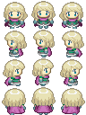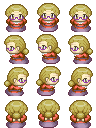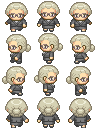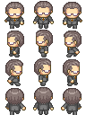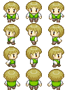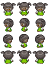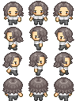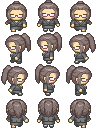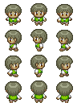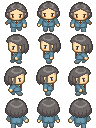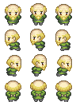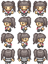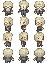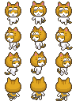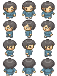
</p>

#### `generative-agents/characters/profile`

<p>
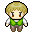
</p>

#### `generative-agents/map_assets/v1`

**`Interiors_32x32_full.png`**


**`interiors_pt1.png`**


**`interiors_pt2.png`**


**`interiors_pt3.png`**


**`interiors_pt4.png`**


**`interiors_pt5.png`**


**`Room_Builder_32x32.png`**


#### `generative-agents/map_assets/v2`

**`TopDownHouse_DoorsAndWindows.png`**


**`TopDownHouse_FloorsAndWalls.png`**


**`TopDownHouse_FurnitureState1.png`**


**`TopDownHouse_FurnitureState2.png`**


**`TopDownHouse_SmallItems.png`**


#### `generative-agents/map_assets/v3`

**`tileset-grassland-grass.png`**


**`tileset-grassland-paths.png`**


**`tileset-grassland-props.png`**


**`tileset-grassland-water.png`**


#### `generative-agents/speech_bubble`

<p>

</p>

---

### Gource

[Gource](https://github.com/acaudwell/Gource) — **13,138 ★** — `3` files in `reference/gource/`

<p>

</p>

---

### AI Town

[AI Town](https://github.com/a16z-infra/ai-town) — **10,473 ★** — `57` files in `reference/ai-town/`

**`background.webp`**


#### `ai-town/editor`

**`campfire.png`**


**`doll.png`**


**`forest.png`**


**`gentle-obj.png`**


**`gentle.png`**


**`gentlesparkle32.png`**


**`gentlewaterfall32.png`**


**`magecity.png`**


**`peeps.png`**


**`phantasy2.png`**


**`Serene.png`**


**`tall.png`**


**`windmill.png`**


**`women.png`**


#### `ai-town/public-assets`

**`32x32folk.png`**


**`gentle-obj.png`**


**`heart-empty.png`**


**`magecity.png`**


**`player.png`**


**`rpg-tileset.png`**


#### `ai-town/public-assets/spritesheets`

**`campfire.png`**


**`gentlesparkle32.png`**


**`gentlewaterfall32.png`**


**`windmill.png`**


#### `ai-town/spritesheets`

**`campfire.png`**


**`doll.png`**


**`gentlesparkle32.png`**


**`gentlewaterfall32.png`**


**`peeps.png`**


**`tall.png`**


**`windmill.png`**


**`women.png`**


#### `ai-town/tilesets`

**`forest.png`**


**`gentle-obj.png`**


**`gentle.png`**


**`magecity.png`**


**`phantasy2.png`**


**`Serene.png`**


#### `ai-town/ui`

**`background.webp`**


<p>

</p>

---

### pixel-agents

[pixel-agents](https://github.com/pixel-agents-hq/pixel-agents) — **9,243 ★** — `64` files in `reference/pixel-agents/`

#### `pixel-agents/assets/carpets`

<p>

</p>

#### `pixel-agents/assets/characters`

<p>

</p>

#### `pixel-agents/assets/floors`

<p>

</p>

#### `pixel-agents/assets/furniture/BIN`

<p>

</p>

#### `pixel-agents/assets/furniture/BOOKSHELF`

<p>

</p>

#### `pixel-agents/assets/furniture/CACTUS`

<p>

</p>

#### `pixel-agents/assets/furniture/CLOCK`

<p>

</p>

#### `pixel-agents/assets/furniture/COFFEE`

<p>

</p>

#### `pixel-agents/assets/furniture/COFFEE_TABLE`

<p>

</p>

#### `pixel-agents/assets/furniture/CUSHIONED_BENCH`

<p>

</p>

#### `pixel-agents/assets/furniture/CUSHIONED_CHAIR`

<p>

</p>

#### `pixel-agents/assets/furniture/DESK`

<p>

</p>

#### `pixel-agents/assets/furniture/DOUBLE_BOOKSHELF`

<p>

</p>

#### `pixel-agents/assets/furniture/HANGING_PLANT`

<p>

</p>

#### `pixel-agents/assets/furniture/LARGE_PAINTING`

<p>

</p>

#### `pixel-agents/assets/furniture/LARGE_PLANT`

<p>

</p>

#### `pixel-agents/assets/furniture/PC`

<p>

</p>

#### `pixel-agents/assets/furniture/PLANT`

<p>

</p>

#### `pixel-agents/assets/furniture/PLANT_2`

<p>

</p>

#### `pixel-agents/assets/furniture/POT`

<p>

</p>

#### `pixel-agents/assets/furniture/SMALL_PAINTING`

<p>

</p>

#### `pixel-agents/assets/furniture/SMALL_PAINTING_2`

<p>

</p>

#### `pixel-agents/assets/furniture/SMALL_TABLE`

<p>

</p>

#### `pixel-agents/assets/furniture/SOFA`

<p>

</p>

#### `pixel-agents/assets/furniture/TABLE_FRONT`

<p>

</p>

#### `pixel-agents/assets/furniture/WHITEBOARD`

<p>

</p>

#### `pixel-agents/assets/furniture/WOODEN_BENCH`

<p>

</p>

#### `pixel-agents/assets/furniture/WOODEN_CHAIR`

<p>

</p>

#### `pixel-agents/assets/pets/claudio`

<p>

</p>

#### `pixel-agents/assets/pets/gitcat`

<p>

</p>

#### `pixel-agents/assets/walls`

<p>

</p>

**`banner.png`**


**`characters.png`**


**`office.png`**


**`Screenshot.jpg`**


<p>

</p>

---

### 3d.city

[3d.city](https://github.com/lo-th/3d.city) — **1,744 ★** — `15` files in `reference/3d-city/`

#### `3d-city/img`

**`build_0.png`**


**`build_1.png`**


**`preview01.jpg`**


**`preview02.jpg`**


**`preview03.jpg`**


**`tuto.png`**


<p>

</p>

#### `3d-city/textures`

**`building.png`**


**`cars.png`**


**`ground1k.png`**


**`road.png`**


**`tiles.png`**


**`title.png`**


**`town.png`**


---

### JSCity

[JSCity](https://github.com/aserg-ufmg/JSCity) — **1,400 ★** — `80` files in `reference/jscity/`

#### `jscity/cities`

**`ace.png`**


**`algorithmsjs.png`**


**`algoritmsjs.png`**


**`angular.png`**


**`angularjs.png`**


**`backbone.png`**


**`bootstrap.png`**


**`bower.png`**


**`cappuccino.png`**


**`chart.png`**


**`chartjs.png`**


**`clumsy-bird.png`**


**`clumsybird.png`**


**`crafty.png`**


**`d3js.png`**


**`Deck.png`**


**`deckjs.png`**


**`dexter.png`**


**`dojo.png`**


**`dust.png`**


**`easelJs.png`**


**`ember.png`**


**`express.png`**


**`florajs.png`**


**`ghost.png`**


**`grunt.png`**


**`gulp.png`**


**`impress.png`**


**`impressjs.png`**


**`intern.png`**


**`ionic.png`**


**`isome.png`**


**`isomer.png`**


**`istanbul.png`**


**`jade.png`**


**`jasmine (2).png`**


**`jasmine.png`**


**`jasmini.png`**


**`jquery-file-upload.png`**


**`jquery.png`**


**`jqueryfileupload.png`**


**`js-git.png`**


**`karma.png`**


**`knockout.png`**


**`leaflet.png`**


**`less.png`**


**`meteor.png`**


**`mocha.png`**


**`modernizr.png`**


**`mootools.png`**


**`move.png`**


**`mustache.png`**


**`paper.png`**


**`paperjs.png`**


**`parallax.png`**


**`pdfjs.png`**


**`phase.png`**


**`pixi.png`**


**`pug.png`**


**`quintus.png`**


**`react.png`**


**`respond.png`**


**`reveal.png`**


**`riot.png`**


**`rot.png`**


**`select2.png`**


**`semantic-ui.png`**


**`semanticui.png`**


**`slick.png`**


**`snap.png`**


**`socket.io.png`**


**`soket.io.png`**


**`textillate.png`**


**`threejs.png`**


**`tween.png`**


**`underscore.png`**


**`velocity.png`**


**`zepto.png`**


<p>

</p>

---

### agent-office

[agent-office](https://github.com/harishkotra/agent-office) — **265 ★** — `7` files in `reference/agent-office/`

**`characters.png`**


<p>

</p>

---

### city-tour

[city-tour](https://github.com/jstrait/city-tour) — **88 ★** — `2` files in `reference/city-tour/`

**`city_tour.gif`**


<p>

</p>

---

### agent-town

[agent-town](https://github.com/rafapetter/agent-town) — **5 ★** — `11` files in `reference/agent-town/`

**`dashboard-agents.png`**


**`dashboard-analytics.png`**


**`dashboard-kanban.png`**


**`dashboard-timeline.png`**


**`playground-agents.png`**


**`playground-farm.png`**


**`playground-office.png`**


**`playground-pirate-ship.png`**


**`playground-rocket.png`**


**`playground-space-station.png`**


**`playground-town.png`**


---

### CodeCity

[CodeCity](https://wettel.github.io/codecity.html) — **— ★** — `12` files in `reference/code-city/`

**`codecity-ated-ict-2008.png`**


**`codecity-screenshot.png`**


**`gource-git.jpg`**


**`gource-linux.jpg`**


**`gource-papervision.jpg`**


#### `code-city/wof`

**`argouml.png`**


**`codecity.png`**


**`jdk.png`**


**`jhotdraw7.png`**


**`jmol.png`**


**`moose-suite.png`**


**`vuze.png`**


---

## `> data_sources`

**Transcripts primary, hooks optional.** `~/.claude/projects/<slug>/<uuid>.jsonl`, one
JSON object per line, appended live. Confirmed fields include `isSidechain` (this is
how subagents get bodies), `uuid` / `parentUuid` (causality, not just order),
`timestamp`, `durationMs`, `cwd`, `gitBranch` and full `tool_use` blocks.

```bash
you@github:~$ ls ~/.claude/projects/

  SESSIONS:       1,553 .jsonl files
  SIZE:           2.5 GB
  LARGEST:        17,256 lines in one session
  SUBAGENTS:      flagged inline via isSidechain
```

> **Hooks give you the future. Transcripts give you the past.** `pixel-agents` uses
> hooks as primary, which proves the per-call latency is tolerable - but hooks cannot
> retroactively recover a single one of those 1,553 sessions. The chronicle is the
> distinctive half of this project, so transcripts lead and hooks are a live-fidelity
> upgrade. Copy the `pixel-agents` pattern: one event model, one provider interface,
> renderer never knows which source fed it.

---

## `> what_this_changes`

Four things worth stealing outright:

| From | Steal |
|:--|:--|
| `token-dashboard` | The whole pipeline shape - Python stdlib + SQLite + vanilla JS, no build step. Already the house pattern, and the 20-60 s scan figure makes M0 an evening |
| `JSCity` | The metric mapping. Do not re-derive what height and footprint should mean |
| `AI Town` | "Historical objects" - client-side interpolation between sparse, lumpy state updates. Exactly the problem a tool-call-driven city has |
| `pixel-agents` | The dual-source provider interface, the activity-driven character animation, and the `furniture/*/manifest.json` sprite format |

And one thing to be honest about: **the overlap with `pixel-agents` on the live half is
substantial.** Reading or forking it beats rebuilding the citizen layer. The novel
work here is the terrain and the chronicle.

---

## `> tree`

```bash
Agent City/
├── README.md                 # this file
├── IDEA.md                   # the full design doc
└── reference/                # competitor assets, mirrored for study
    ├── README.md             # the three design patterns, side by side
    ├── ATTRIBUTION.md        # licences + what was deliberately NOT mirrored
    ├── generative-agents/    # 22,087 ★ Smallville map + characters + tiles
    ├── gource/               # 13,138 ★ beam/file/user sprites
    ├── ai-town/              # 10,473 ★ tilesets, spritesheets, UI
    ├── pixel-agents/         #  9,243 ★ office furniture + character sheets
    ├── 3d-city/              #  1,744 ★ previews + building textures
    ├── jscity/               #  1,400 ★ 60 city stills (Angular, jQuery, …)
    ├── agent-office/         #    265 ★ character sprites
    ├── city-tour/            #     88 ★ city_tour.gif
    ├── agent-town/           #      5 ★ 11 screenshots, 7 themed playgrounds
    └── code-city/            # academic original + Wall of Fame stills
```

---

## `> build_order`

| Milestone | What | Effort |
|:--|:--|:--|
| **M0** | Corpus survey - parse all 1,553 transcripts into `city.db` | One evening |
| **M1** | Static skyline - one district from a filesystem walk, no motion | |
| **M2** | Chronicle - replay one recorded session over M1, with a scrub bar | |
| **M3** | Live City - tail the active session file | |
| **M4** | Whole-corpus timelapse + video export | The shareable artifact |
| **M5** | Packaging - pywebview shell, tray icon, autostart | |

M0 through M2 is the honest minimum for something worth showing.

---

## `> stats --live`

| METRIC | COUNT | NOTES |
|:------:|:-----:|:-----:|
| **Sessions on disk** | `1,553` | `~/.claude/projects/**/*.jsonl` |
| **Corpus size** | `2.5 GB` | Grows every session |
| **Largest session** | `17,256` | Lines in one `.jsonl` |
| **Prior-art projects surveyed** | `15` | Across three camps, tables sorted by stars |
| **Reference assets mirrored** | `350` images | All embedded in this README. 40 MB under `reference/`, licences in `ATTRIBUTION.md` |
| **Lines of Agent City code** | `0` | Idea stage |

---

## `> related_projects`

| Repo | What |
|:-----|:-----|
| [Ringmast4r/argus](https://github.com/Ringmast4r/argus) | Globe visualisation - the other big render project |
| [Ringmast4r/Gods-Eye-Index](https://github.com/Ringmast4r/Gods-Eye-Index) | DB-generated README, same "db is truth" pattern |

<div align="center">

**Maintained by** [@Ringmast4r](https://github.com/Ringmast4r)


</div>
