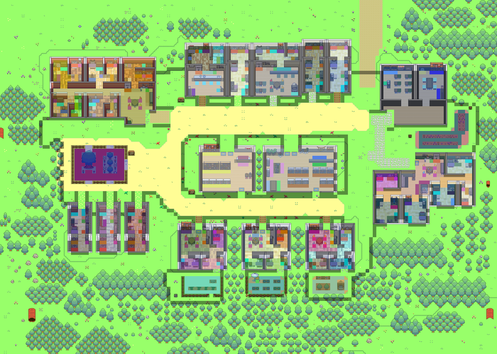
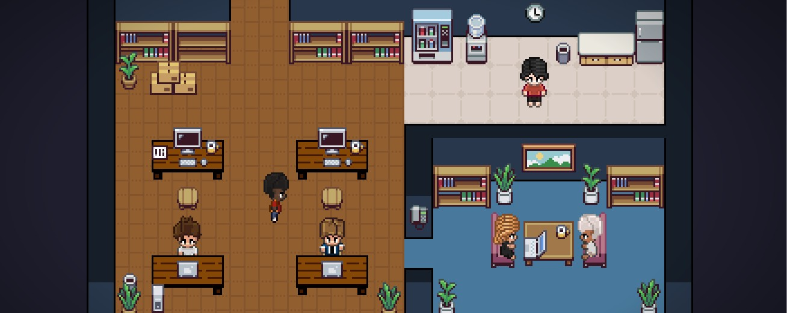
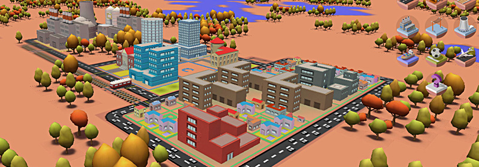
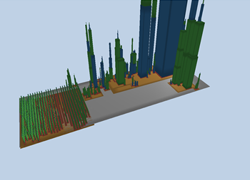
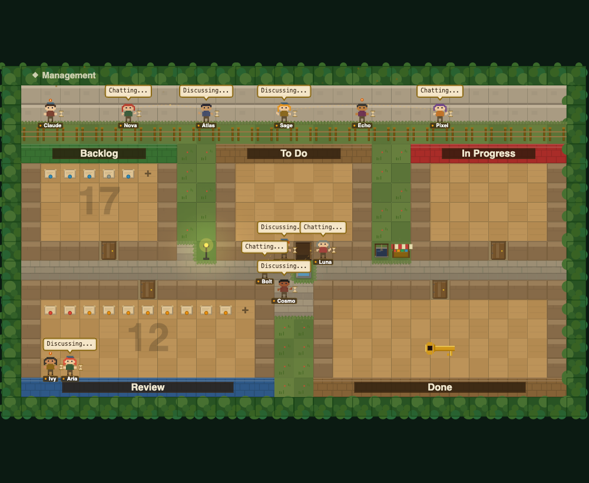

<div align="center">


[](https://git.io/typing-svg)

<br>

[](#-what_is_this)
[](#-data_sources)
[](https://threejs.org/)
[](#-prior_art)

[](https://github.com/Ringmast4r/agent-city/stargazers)
[](https://github.com/Ringmast4r/agent-city/network/members)
[](#)
[](https://github.com/Ringmast4r/agent-city/commits/main)
[](#)

</div>

---

## `> what_is_this`

```bash
you@github:~$ cat project.txt

  PURPOSE:        render my own Claude Code sessions as an isometric city
  DISTRICTS:      the numbered D: libraries (00 Database ... 27 Chrome Ext)
  BUILDINGS:      real files - height = LOC, footprint = size
  CITIZENS:       real tool calls and subagents, read from transcripts
  CORPUS:         1,553 sessions | 2.5 GB | biggest session 17,256 lines
  STATUS:         [ IDEA STAGE - NOTHING BUILT YET ]
```

> **The city is not a simulation, it is a read-out.** Every person on screen is an
> actual tool call that actually happened, in an actual file, at an actual timestamp.

Full design doc: **[IDEA.md](IDEA.md)**. Competitor assets and what they look like:
**[reference/](reference/README.md)**.

---

## `> is_it_possible`

Yes, and it is less speculative than it sounds. Every individually risky piece is
already shipping in someone else's project. Nothing here needs inventing - it needs
combining.

| Risky-sounding piece | Already proven by | Verdict |
|:--|:--|:--|
| Reading agent activity out of Claude Code live | `pixel-agents`, 9,243 stars | Solved, two ways |
| Parsing a multi-GB `~/.claude/projects` corpus | `token-dashboard` - Python stdlib + SQLite, 20-60 s full scan | Solved, at this exact scale |
| Turning a file tree into a 3D city in a browser | `JSCity` (three.js) | Solved |
| Animating repo history over a time axis | `Gource`, since 2009 | Solved |
| Little people walking around doing agent work | `pixel-agents`, `agent-town`, `AI Town` | Solved |

**What nobody has done is join them.** The field splits into three camps that have
never met - see [reference/README.md](reference/README.md) for the screenshots that
make this obvious:

| Camp | Example | The map means... |
|:--|:--|:--|
| Map-as-office | `pixel-agents` | Nothing. It is furniture. All signal is in the characters |
| Map-as-workflow | `agent-town` | Task state - agents stand in `Backlog` / `In Progress` / `Done` zones |
| Map-as-codebase | `CodeCity`, `JSCity` | The code itself - but static, empty, no clock and no people |

Agent City is the join: **real terrain from the actual file tree, walked by real
citizens from actual tool calls, over a real time axis** - plus the thing nobody else
has at all, a back catalogue of 1,553 sessions to replay as a chronicle.

---

## `> prior_art`

Surveyed 2026-09-11, **sorted by GitHub stars**. Screenshots and sprites are under [`reference/`](reference/README.md) so you can see what each one actually looks like.

### Agent-as-citizen (the people)

| Project | Stars | Stack | How it knows what the agent is doing |
|:--|--:|:--|:--|
| **[Generative Agents](https://github.com/joonspk-research/generative_agents)** * | **22,087** | Python + Django, Phaser frontend (Smallville) | Simulated. The 2023 paper that started the aesthetic |
| **[AI Town](https://github.com/a16z-infra/ai-town)** * | **10,473** | **PixiJS + pixi-react**, **Convex** (db + serverless + vector search), Clerk, Fly.io | Simulated. 60 ticks/s bundled into one DB step/s; clients replay "historical objects" for smooth motion between sparse writes |
| **[pixel-agents](https://github.com/pixel-agents-hq/pixel-agents)** * | **9,243** | TypeScript, React 19 + Vite, **Canvas 2D**, Fastify, Node 20+, esbuild, Vitest + Playwright | **Real telemetry.** Claude Code **hooks primary** (`SessionStart`, `PreToolUse`, `PermissionRequest`, `Stop`) with a **JSONL fallback** over `~/.claude/projects/`. Both normalise into one `AgentEvent` model behind a typed `HookProvider` interface |
| [agent-office](https://github.com/harishkotra/agent-office) * | 265 | Phaser.js, Colyseus, React, SQLite, Ollama | Simulated - a think loop every ~15 s. SQLite memories with embedding + cosine recall |
| [agent-town](https://github.com/rafapetter/agent-town) * | 5 | Pure TypeScript, **zero dependencies**, Canvas 2D, procedural pixel art | Direct TS API (`addAgent`, `updateAgent`, `logActivity`) plus a WebSocket bridge for Claude Code / Cursor / Codex |

### Code-as-city (the buildings)

| Project | Stars | Stack | Mapping |
|:--|--:|:--|:--|
| **[Gource](https://github.com/acaudwell/gource)** * | **13,138** | C++, OpenGL/SDL | Repo history as an animated tree, committers as avatars. The time axis done right |
| **[3d.city](https://github.com/lo-th/3d.city)** * | **1,744** | three.js, WebGL2/WebGPU | Procedural city builder - layout, camera, textured blocks |
| **[JSCity](https://github.com/aserg-ufmg/JSCity)** * | **1,400** | **three.js** | Folders are districts, files are sub-districts, **buildings are functions**; height = LOC, base = variable count |
| [city-tour](https://github.com/jstrait/city-tour) * | 88 | three.js, WebGL | Procedural city generation - layout and camera reference |
| [CodeCity](https://wettel.github.io/codecity.html) * (Wettel, 2008) | — | VisualWorks Smalltalk on Moose, OpenGL | Packages are districts, classes are buildings, methods are floors. **The target look.** No GitHub repo; academic original |

### Claude Code transcript tooling (the data pipeline)

| Project | Stars | Stack | Notes |
|:--|--:|:--|:--|
| [claude-code-transcripts](https://github.com/simonw/claude-code-transcripts) | **1,686** | Python | JSONL to paginated static HTML |
| [claude-code-log](https://github.com/daaain/claude-code-log) | 1,213 | Python CLI | JSONL to HTML / Markdown |
| **[token-dashboard](https://github.com/nateherkai/token-dashboard)** | 694 | **Python 3 stdlib only**, **SQLite**, vanilla JS + ECharts, **no build step** | Scans `~/.claude/projects/`, dedupes by `message.id`, **20-60 s full initial scan on a heavy machine**, re-scan every 30 s over SSE. Tool and file heatmaps |
| [ClaudeCodeJSONLParser](https://github.com/amac0/ClaudeCodeJSONLParser) | 20 | HTML tool | JSONL events and git history on one timeline - closest to the chronicle idea |

---

## `> look`

Highest stars first. These files live in this repo under `reference/`, so they render here and open on disk.

<table>
<tr>
<td width="50%" valign="top">

**Generative Agents — 22,087 ★**
Smallville. The map is furniture; the paper that started the look.



</td>
<td width="50%" valign="top">

**Gource — 13,138 ★**
Repo history as a growing tree. The time axis, done.


</td>
</tr>
<tr>
<td width="50%" valign="top">

**AI Town — 10,473 ★**
PixiJS town, OpenGameArt tiles.


</td>
<td width="50%" valign="top">

**pixel-agents — 9,243 ★**
Top-down office. Real Claude Code telemetry. Map is furniture.



</td>
</tr>
<tr>
<td width="50%" valign="top">

**3d.city — 1,744 ★**
Procedural textured city. Pretty, not a metric.



</td>
<td width="50%" valign="top">

**JSCity — 1,400 ★**
AngularJS as a three.js city. Height = LOC.



</td>
</tr>
<tr>
<td width="50%" valign="top">

**CodeCity — 2008, the target look**
Flat colour, no texture. Every box is a class.


</td>
<td width="50%" valign="top">

**agent-town — 5 ★**
Kanban as terrain. Position = task state.



</td>
</tr>
</table>

More stills: [JSCity cities](reference/jscity/cities/) (60 systems), [CodeCity Wall of Fame](reference/code-city/wof/), [city-tour.gif](reference/city-tour/city_tour.gif), [3d.city previews](reference/3d-city/img/).

---

## `> data_sources`

**Transcripts primary, hooks optional.** `~/.claude/projects/<slug>/<uuid>.jsonl`, one
JSON object per line, appended live. Confirmed fields include `isSidechain` (this is
how subagents get bodies), `uuid` / `parentUuid` (causality, not just order),
`timestamp`, `durationMs`, `cwd`, `gitBranch` and full `tool_use` blocks.

```bash
you@github:~$ ls ~/.claude/projects/

  SESSIONS:       1,553 .jsonl files
  SIZE:           2.5 GB
  LARGEST:        17,256 lines in one session
  SUBAGENTS:      flagged inline via isSidechain
```

> **Hooks give you the future. Transcripts give you the past.** `pixel-agents` uses
> hooks as primary, which proves the per-call latency is tolerable - but hooks cannot
> retroactively recover a single one of those 1,553 sessions. The chronicle is the
> distinctive half of this project, so transcripts lead and hooks are a live-fidelity
> upgrade. Copy the `pixel-agents` pattern: one event model, one provider interface,
> renderer never knows which source fed it.

---

## `> what_this_changes`

Four things worth stealing outright:

| From | Steal |
|:--|:--|
| `token-dashboard` | The whole pipeline shape - Python stdlib + SQLite + vanilla JS, no build step. Already the house pattern, and the 20-60 s scan figure makes M0 an evening |
| `JSCity` | The metric mapping. Do not re-derive what height and footprint should mean |
| `AI Town` | "Historical objects" - client-side interpolation between sparse, lumpy state updates. Exactly the problem a tool-call-driven city has |
| `pixel-agents` | The dual-source provider interface, the activity-driven character animation, and the `furniture/*/manifest.json` sprite format |

And one thing to be honest about: **the overlap with `pixel-agents` on the live half is
substantial.** Reading or forking it beats rebuilding the citizen layer. The novel
work here is the terrain and the chronicle.

---

## `> tree`

```bash
Agent City/
├── README.md                 # this file
├── IDEA.md                   # the full design doc
└── reference/                # competitor assets, mirrored for study
    ├── README.md             # the three design patterns, side by side
    ├── ATTRIBUTION.md        # licences + what was deliberately NOT mirrored
    ├── generative-agents/    # 22,087 ★ Smallville map + characters + tiles
    ├── gource/               # 13,138 ★ beam/file/user sprites
    ├── ai-town/              # 10,473 ★ tilesets, spritesheets, UI
    ├── pixel-agents/         #  9,243 ★ office furniture + character sheets
    ├── 3d-city/              #  1,744 ★ previews + building textures
    ├── jscity/               #  1,400 ★ 60 city stills (Angular, jQuery, …)
    ├── agent-office/         #    265 ★ character sprites
    ├── city-tour/            #     88 ★ city_tour.gif
    ├── agent-town/           #      5 ★ 11 screenshots, 7 themed playgrounds
    └── code-city/            # academic original + Wall of Fame stills
```

---

## `> build_order`

| Milestone | What | Effort |
|:--|:--|:--|
| **M0** | Corpus survey - parse all 1,553 transcripts into `city.db` | One evening |
| **M1** | Static skyline - one district from a filesystem walk, no motion | |
| **M2** | Chronicle - replay one recorded session over M1, with a scrub bar | |
| **M3** | Live City - tail the active session file | |
| **M4** | Whole-corpus timelapse + video export | The shareable artifact |
| **M5** | Packaging - pywebview shell, tray icon, autostart | |

M0 through M2 is the honest minimum for something worth showing.

---

## `> stats --live`

| METRIC | COUNT | NOTES |
|:------:|:-----:|:-----:|
| **Sessions on disk** | `1,553` | `~/.claude/projects/**/*.jsonl` |
| **Corpus size** | `2.5 GB` | Grows every session |
| **Largest session** | `17,256` | Lines in one `.jsonl` |
| **Prior-art projects surveyed** | `15` | Across three camps, tables sorted by stars |
| **Reference assets mirrored** | `397` | 40 MB under `reference/`, licences in `ATTRIBUTION.md` |
| **Lines of Agent City code** | `0` | Idea stage |

---

## `> related_projects`

| Repo | What |
|:-----|:-----|
| [Ringmast4r/argus](https://github.com/Ringmast4r/argus) | Globe visualisation - the other big render project |
| [Ringmast4r/Gods-Eye-Index](https://github.com/Ringmast4r/Gods-Eye-Index) | DB-generated README, same "db is truth" pattern |

<div align="center">

**Maintained by** [@Ringmast4r](https://github.com/Ringmast4r)


</div>
